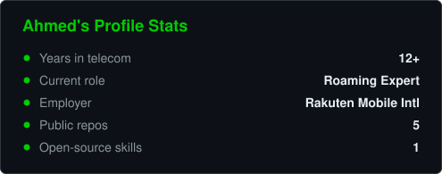
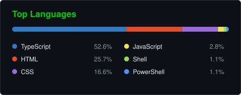

# Hi, I'm Ahmed 👋

*"Ambition is a method, not a mood."*

## 🧭 About

Roaming Expert at **Rakuten Mobile International (RMI)**, with **12+ years** in mobile core networks and international roaming. I work where **carrier-grade operations, APIs, and AI** meet, and I care about correctness, observability, and things that survive real traffic. Outside the day job I build in **Web3 and AI agents** and run a Japan-to-Cyprus car import business.

## ⚡ What I Do

- **Roaming & Interworking**: TAP/RAP/NRTRDE, IREG testing, roaming partner onboarding, GSMA processes (IR.21, IR.34, IR.50, IR.65, RAEX).
- **Mobile Core & Signalling**: Diameter, SS7, SIP, 5G SA, IMS, HSS/PGW, VNF lifecycle, migrations and decommissioning.
- **Network APIs**: CAMARA / GSMA Open Gateway, API design and integration specs.
- **Charging & Data**: CDR, OCS, OFCS pipelines, KPI dashboards in Power BI and QlikSense.
- **AI & Agents**: multi-agent dev-team frameworks, Claude skills, self-education systems.
- **Web3**: blockchain products and crypto trading tooling.

## 🛠️ Tech Stack

**Telecom**

**Languages & Frontend**

**Data & BI**

**AI & Automation**

**Infra & Tooling**

## ✨ Open Source Projects

| Project | Description | Tech |
| ------- | ----------- | ---- |
| [**be-more-ambitious**](https://github.com/Rebellion1991/be-more-ambitious) | Claude skill that raises the ambition of any task or prompt: aim at the outcome, work like a top expert, bring in other fields (MIT) | `Claude skill` |
| [**Portfolio-Website**](https://github.com/Rebellion1991/Portfolio-Website) | Source of [shenawy.xyz](https://shenawy.xyz): experience, education and courses, with a contact form | `TypeScript` |

## 🚀 Recent Apps

| App | Description |
| --- | ----------- |
| [**AltraderX**](https://altraderx.com) | Crypto trading platform |
| [**NestCheck**](https://nestcheck.app) | Cohabitation compatibility quiz for couples |
| **property-care** | Property care and maintenance app |
| **travel-sniper** | Travel deal tracking app |

## 📊 GitHub Stats

<picture>
  <source media="(prefers-color-scheme: dark)" srcset="img/stats/stats-dark.svg">
  <source media="(prefers-color-scheme: light)" srcset="img/stats/stats-light.svg">
  
</picture>
<picture>
  <source media="(prefers-color-scheme: dark)" srcset="img/stats/top-langs-dark.svg">
  <source media="(prefers-color-scheme: light)" srcset="img/stats/top-langs-light.svg">
  
</picture>

❤️ Always learning. Open to collaboration on telecom APIs, agent tooling, and ambitious open-source work.

